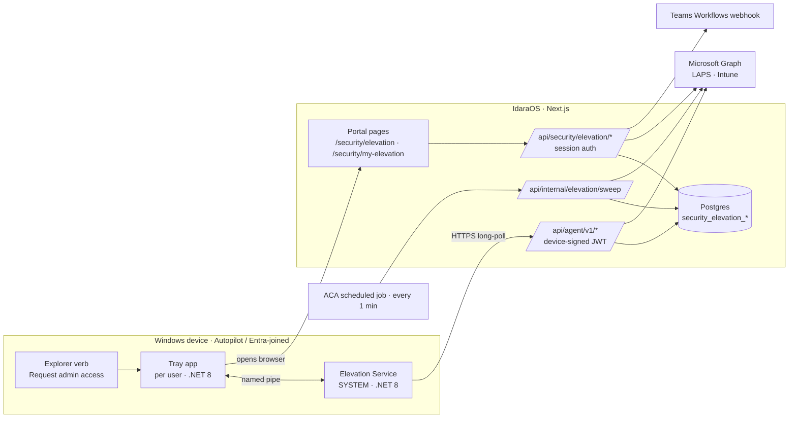
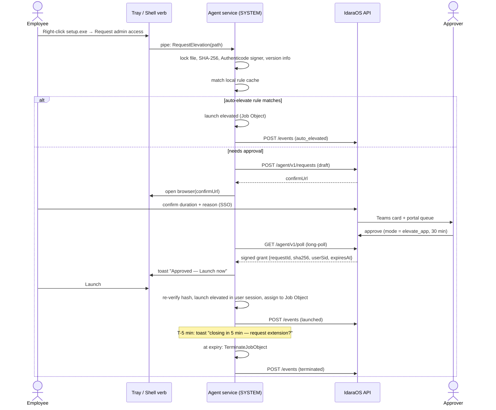

# Security › Endpoint Elevation (Just-in-Time Admin) — Implementation Plan

> Status: **Planned** · Owner: Security module · Target: Windows 11, Autopilot Entra-joined, Intune-managed, Windows LAPS backed up to Entra ID

## 1. Goal

Standard users never hold permanent local admin rights. When they need elevation they request it, an approver decides **how** to grant it, and every step is time-boxed and audited.

| Capability | Who | Summary |
|---|---|---|
| Request elevation for an app | Employee | Right-click an `.exe`/`.msi` → "Request admin access", or request from the portal. Picks duration + reason. |
| Approve / deny | Approver (IT) | Chooses the **grant mode**, may shorten the duration. |
| **Mode A — Credentials** | Approver with credential permission | LAPS password fetched from Entra via Graph, revealed to the requester in the portal, rotated at expiry. |
| **Mode B — Elevate app** | Approver | Agent launches *only that app* elevated for the window. No password shown to the user. Warns at T-5 min, closes the app at expiry. |
| Auto-elevate catalog | Super admin | Apps that always run elevated with no request (scoped to users / groups / devices). |
| Sign-in | Everyone | Microsoft Entra SSO only (existing IdaraOS SSO, `passwordAuthDisabled = true`). |

Not in scope (v1): macOS, intercepting the native UAC prompt on double-click (needs a kernel driver / credential provider), on-prem AD LAPS.

## 2. Architecture



**Why Next.js + a native agent, not Electron:** all UI (requesting, approving, revealing passwords, managing rules) lives in the IdaraOS portal, where Entra SSO and RBAC already exist. Only a SYSTEM service can start an elevated process. Electron can't, so the device side is a small .NET service plus a tray app (~15 MB, deployed by Intune).

### Key design decision — the user confirms in the browser

The tray app never handles user tokens. The agent creates a **draft** request (with file identity, device and logged-on user from the pipe client's token). It then opens the browser at `/security/my-elevation/confirm/{draftId}`, where the SSO-authenticated user picks the duration and reason. The server checks that the portal user matches the device's logged-on user (Entra UPN/object ID reported by the agent). One sign-in path, no MSAL/WAM code in the agent.

## 3. Flows

### 3.1 Request → approve → elevate app (Mode B)



### 3.2 Credentials (Mode A)

1. The approver picks **Credentials**. This needs `security.elevation-credentials:edit` and is allowed only if org settings enable credential mode.
2. A grant is created with `expiresAt`. The requester sees a **Reveal password** card on `/security/my-elevation` with a countdown.
3. Reveal → `POST /api/security/my-elevation/grants/{id}/reveal`:
   - Requires an SSO login within the last 15 min; otherwise redirect with `prompt=login`.
   - Server calls Graph `GET /directory/deviceLocalCredentials/{entraDeviceId}?$select=credentials` (headers `ocp-client-name`, `ocp-client-version`), picks the newest `backupDateTime`, base64-decodes `passwordBase64`.
   - Returns `{ accountName, password }` with `Cache-Control: no-store`. Nothing is persisted or logged. `revealCount` and `credentialRevealedAt` are recorded.
   - Rate limit: 5 reveals per grant.
4. **Rotation at expiry (two layers):**
   - **Primary:** the agent tracks `expiresAt` locally and runs `Reset-LapsPassword` as SYSTEM. This rotates immediately and backs up to Entra. It also logs off any session running as the LAPS account.
   - **Fallback:** the sweep job checks Graph `backupDateTime`. If it isn't newer than the reveal 10 min after expiry, it calls Intune `POST /beta/deviceManagement/managedDevices/{intuneDeviceId}/rotateLocalAdminPassword` and marks `rotationStatus = requested`.
   - **Belt and braces:** the Intune LAPS policy sets `PostAuthenticationActions = Reset password + logoff` and `PostAuthenticationResetDelay` = max grant hours.

Mode A works **without the agent** (rotation then uses only the Intune fallback). That's why it ships first (Phase 1).

### 3.3 Grant expiry & revocation

- The agent enforces `expiresAt` locally, so it works offline. The server sweep marks grants `expired` and rotates passwords.
- An approver can **revoke** an active grant. The agent receives it on the next poll (≤ 30 s) and terminates the Job Object (Mode B) or rotates the password (Mode A).
- **Extension:** the T-5 toast offers "Request extension". This creates a new request linked via `parentGrantId`, prefilled.

## 4. Elevation strategy (agent) — must be validated in Phase 0

Requesters are standard users, so their token has no linked admin token to borrow. The service implements `IElevationStrategy` and the Phase 0 spike chooses the default:

| # | Strategy | How | Pros | Cons |
|---|---|---|---|---|
| **1 (preferred)** | Elevate as current user | `LsaLogonUser` (S4U) as SYSTEM with `LocalGroups` += `BUILTIN\Administrators`, set token session ID → `CreateProcessAsUser` into the user's desktop | Correct user profile (per-user installs land correctly); no password leaves the server | S4U support for **cloud-only Entra accounts** must be proven on an Autopilot device |
| **2 (fallback)** | Run as the LAPS account | Server returns the LAPS password **encrypted to the device key** (JWE ECDH-ES). Agent: `LogonUser` → `TokenLinkedToken` (full token) → `CreateProcessAsUser` into the user's session; zero memory; rotate at expiry | Matches the original requirement; known to work | App runs in the admin's profile; password reaches the device (in memory only) |
| ✗ | Add user to local Administrators | — | Simple | Elevates the whole session, not one app. Rejected. |

Prerequisite for strategy 2 and for Mode A: the Intune LAPS policy must manage an **enabled** account. Use Windows LAPS automatic account management (24H2+) or a dedicated custom admin account. The built-in Administrator account is disabled by default.

## 5. Data model

New file `apps/web/lib/db/schema/elevation.ts`, exported from `schema/index.ts`. Migration `apps/web/drizzle/0016_endpoint_elevation.sql` (follow [DATABASE_MIGRATIONS.md](../../DATABASE_MIGRATIONS.md)). All tables have `org_id` → `organizations` with cascade delete, matching existing modules.

| Table | Key columns |
|---|---|
| `security_elevation_settings` | `org_id` (PK), `duration_options int[]` (default 15/30/60/120/240), `max_minutes`, `credential_mode_enabled`, `require_reason`, `warn_before_minutes` (5), `teams_webhook_url_encrypted`, `default_mode` |
| `security_elevation_enrollment_tokens` | `id`, `token_hash`, `expires_at`, `max_uses`, `uses`, `created_by`, `revoked_at` |
| `security_elevation_devices` | `id`, `asset_id` → `assets_assets` (nullable), `entra_device_id` (unique per org), `intune_device_id`, `hostname`, `serial_number`, `os_version`, `agent_version`, `public_key_jwk`, `status` (`pending`/`active`/`revoked`), `last_seen_at`, `last_user_upn`, `enrolled_at` |
| `security_elevation_device_apps` | `device_id`, `name`, `publisher`, `version`, `path`, `sha256`, `signer_subject`, `signer_thumbprint`, `last_seen_at` — inventory for portal-side requests and rule authoring |
| `security_elevation_rules` | `id`, `name`, `action` (`auto_elevate`/`require_approval`/`block`), `match` jsonb (`signerSubject`, `signerThumbprint?`, `productName?`, `fileName?`, `sha256?`, `minVersion?`), `scope` (`all`/`users`/`groups`/`devices`) + `scope_ids uuid[]`, `allow_child_processes`, `max_minutes?`, `enabled`, `priority`, `created_by`, timestamps |
| `security_elevation_requests` | `id`, `device_id`, `requester_user_id`, `app` jsonb (path, sha256, signer, product, version, args), `requested_minutes`, `reason`, `status` (`draft`/`pending`/`approved`/`denied`/`cancelled`/`expired`), `decided_by`, `decided_at`, `decision_note`, `parent_grant_id`, `draft_expires_at` (10 min) |
| `security_elevation_grants` | `id`, `request_id`, `device_id`, `user_id`, `mode` (`elevate_app`/`credentials`), `starts_at`, `expires_at`, `status` (`active`/`expired`/`revoked`), `delivered_at`, `launched_at`, `ended_at`, `end_reason`, `credential_revealed_at`, `reveal_count`, `rotation_status` (`n/a`/`pending`/`agent_done`/`requested`/`verified`/`failed`) |
| `security_elevation_events` | `id`, `device_id`, `grant_id?`, `user_id?`, `type` (`auto_elevated`, `launched`, `child_blocked`, `warned`, `terminated`, `rotated`, `revealed`, `tamper`), `data` jsonb, `occurred_at` — high-volume device telemetry kept separate from the generic audit log |
| `security_elevation_agent_nonces` | `jti`, `device_id`, `expires_at` — replay protection, purged by sweep |

**Never stored:** LAPS passwords, in any table or log.

**Assets change:** add `entra_device_id` to `assets_assets`, and add `azureADDeviceId` to the `$select` in [route.ts](../../../apps/web/app/api/assets/sync/route.ts) (line 114). LAPS lookups use the **Entra** device ID; the asset sync currently stores only the Intune `managedDevice.id`.

## 6. RBAC

Add these to `MODULES` and `P.security` in [resources.ts](../../../apps/web/lib/rbac/resources.ts). Seed them via `scripts/seed-rbac.ts` / `scripts/sync-rbac-permissions.ts`.

| Module slug | Actions | Default roles |
|---|---|---|
| `security.my-elevation` | `view`, `create` | Everyone (Employee) |
| `security.elevation` | `view` (queue/history), `edit` (approve/deny/revoke) | IT Admin, Security Admin |
| `security.elevation-credentials` | `edit` (may choose Mode A) | Security Admin only |
| `security.elevation-rules` | `view`, `create`, `edit`, `delete` | Super Admin |
| `security.elevation-devices` | `view`, `edit` (enrollment tokens, revoke agent) | IT Admin |

Server-enforced business rules (on top of RBAC):
- The requester can't decide their own request.
- Approved minutes ≤ requested minutes ≤ `max_minutes` (and ≤ the rule's `max_minutes`).
- Mode A is refused if `credential_mode_enabled = false`.

## 7. API surface

**Portal (session auth, `requirePermission(...P.security.…)` + `handleApiError`, like existing routes):**

| Method & path | Purpose |
|---|---|
| `GET /api/security/my-elevation/requests` | My requests + active grants |
| `POST /api/security/my-elevation/requests` | Portal-side request (pick device + inventory app) |
| `GET /api/security/my-elevation/requests/[id]` | Draft/confirm view |
| `POST /api/security/my-elevation/requests/[id]/confirm` | draft → pending (`minutes`, `reason`) |
| `POST /api/security/my-elevation/requests/[id]/cancel` | |
| `POST /api/security/my-elevation/grants/[id]/reveal` | Mode A password (no-store, recent-auth, rate-limited) |
| `GET /api/security/elevation/requests?status=` | Approver queue / history |
| `POST /api/security/elevation/requests/[id]/approve` | `{ mode, minutes, note }` |
| `POST /api/security/elevation/requests/[id]/deny` | `{ note }` |
| `POST /api/security/elevation/grants/[id]/revoke` | |
| `GET, POST /api/security/elevation/rules` · `PATCH, DELETE …/rules/[id]` | Auto-elevate catalog |
| `POST /api/security/elevation/rules/from-request/[id]` | One-click "always allow this app" |
| `GET /api/security/elevation/devices` · `POST …/devices/[id]/revoke` | Agents |
| `GET, POST, DELETE /api/security/elevation/enrollment-tokens` | |
| `GET, PATCH /api/security/elevation/settings` | |

**Agent (`/api/agent/v1/*`).** Added to `publicRoutes` in [middleware.ts](../../../apps/web/middleware.ts), like `/api/scim`. Authenticated by `lib/elevation/agent-auth.ts`: an ES256 JWT signed with the device's TPM key, `iat` ±60 s, single-use `jti`, `sub = deviceId`, device `status = active`.

| Method & path | Purpose |
|---|---|
| `POST /enroll` | Enrollment token + public key + `entraDeviceId`/`intuneDeviceId`/serial. Server cross-checks Graph (device exists, Intune-managed, compliant, serial matches) → `active`, links `asset_id` |
| `POST /heartbeat` | Version, logged-on user, inventory delta → returns `rulesVersion` |
| `GET /rules` | Rules applicable to this device (ETag) |
| `POST /requests` | Create a draft → `{ draftId, confirmUrl }` |
| `GET /poll` | Long-poll ≤ 30 s → new grants, revocations, rule changes |
| `POST /grants/[id]/credential` | Strategy 2 only: JWE-encrypted LAPS password, only while the grant is active and mode is `elevate_app` |
| `POST /events` | Batched telemetry (`launched`, `child_blocked`, `terminated`, `rotated`, …) |

**Internal:** `POST /api/internal/elevation/sweep` (header `x-internal-secret`) expires drafts and grants, verifies and forces rotations, and purges nonces. It's called every minute by an Azure Container Apps scheduled job (and by a `cron` service in `docker-compose.dev.yml`). It also runs opportunistically on agent polls.

**Grants sent to the agent** are signed by the server (ES256 key in env, public key pinned in the agent at install). A compromised API response can't forge a grant.

## 8. Server code layout

```
apps/web/
  lib/db/schema/elevation.ts            tables + types
  lib/elevation/
    laps.ts                             getDeviceLocalCredential(), rotateLocalAdminPassword(), getLatestBackupTime()
    agent-auth.ts                       verify device JWT, nonce store, sign grants (jose)
    state.ts                            request/grant state machine + guards (pure, unit-tested)
    rules.ts                            rule scoping → per-device rule set
    notify.ts                           Teams Workflows webhook Adaptive Card (approve link)
    sweep.ts                            expiry / rotation reconciliation
  lib/api/elevation.ts                  React Query hooks
  app/api/security/elevation/**         approver + admin routes
  app/api/security/my-elevation/**      requester routes
  app/api/agent/v1/**                   agent routes
  app/api/internal/elevation/sweep/route.ts
  app/(dashboard)/security/my-elevation/            my requests, active grants, reveal card
  app/(dashboard)/security/my-elevation/confirm/[id]/
  app/(dashboard)/security/elevation/               approval queue, active grants, history
  app/(dashboard)/security/elevation/rules/
  app/(dashboard)/security/elevation/devices/
  app/(dashboard)/security/elevation/settings/
  components/security/elevation/                    approve dialog, countdown, reveal card, rule editor
```

Navigation: add the entries to `lib/navigation/routes.ts` and `components/app-sidebar.tsx`. Portal actions (approve, deny, revoke, reveal, rule CRUD) go through the existing `createAuditLog` under `security.auditlog`. Device telemetry goes to `security_elevation_events`.

**Graph permissions.** Add these (application permissions, admin consent) in `deployment/azure/scripts/register-entra-app.ps1`:
- `DeviceLocalCredential.Read.All`
- `DeviceManagementManagedDevices.PrivilegedOperations.All` (rotate)
- `DeviceManagementManagedDevices.Read.All` and `Device.Read.All` (likely already present for asset sync)

LAPS read access is high-value. Recommendation: a **certificate credential** instead of the client secret for this app registration, or a separate app registration used only by `lib/elevation/laps.ts`.

## 9. Agent (`apps/elevation-agent/`, .NET 8 solution)

| Project | Role |
|---|---|
| `IdaraOS.Elevation.Service` | Worker Service as `LocalSystem`: enrollment, heartbeat/poll loop, rule cache, file verification, launch strategies, Job Objects, expiry timers, LAPS reset, ETW child-process watcher |
| `IdaraOS.Elevation.Tray` | Per-user tray (WinForms, started via HKLM `Run`): toasts, "Approved apps" launcher, extension button, receives shell-verb invocations |
| `IdaraOS.Elevation.Contracts` | Named-pipe message contracts |
| `IdaraOS.Elevation.Installer` | WiX MSI; properties `SERVER_URL`, `ENROLLMENT_TOKEN`, `GRANT_SIGNING_PUBKEY` |
| `IdaraOS.Elevation.Tests` | xUnit: rule matching, grant validation, expiry logic |

**Implementation details**

**Device identity**
- Entra device ID comes from the MS-Organization-Access cert in `LocalMachine\My` (subject `CN=<deviceId>`). The Intune ID comes from the MDM enrollment registry.
- The key pair is P-256 in the Microsoft Platform Crypto Provider (TPM), non-exportable.

**IPC**
- Named pipe with an ACL for Authenticated Users. The service identifies the caller from the pipe client token (`ImpersonateNamedPipeClient`), never from message fields.

**File identity and TOCTOU protection**
- Open the file with `FILE_SHARE_READ` only, so it can't be modified while held.
- Compute SHA-256 and `WinVerifyTrust` (signer subject + thumbprint), and read `FileVersionInfo`.
- Launch while still holding the handle. `.msi` files launch as `msiexec.exe /i` and are matched on the MSI's signature.

**Rule matching**
- Signer + optional product/minVersion, or exact hash. Path-only rules aren't allowed.
- Rules are cached in `%ProgramData%\IdaraOS\Elevation\rules.dat` (DPAPI machine scope, ACL SYSTEM-only), so auto-elevate works offline.
- New approvals require being online.

**Process containment**
- Each elevated launch goes in a Job Object (`KILL_ON_JOB_CLOSE`), so all children are tracked.
- Warn toast at `expiresAt − warn_before_minutes`, then `TerminateJobObject` at expiry.

**Child-process control**
- ETW `Microsoft-Windows-Kernel-Process` (TraceEvent).
- If the parent is in an elevation job and the image is on the deny list (`cmd`, `powershell`, `pwsh`, `regedit`, `mmc`, `wscript`, `cscript`, `mshta`) and the rule disallows children → terminate it and emit `child_blocked`.

**Explorer integration**
- v1: classic verb for `exefile` / `Msi.Package` ("Show more options" on Win11).
- Phase 4: `IExplorerCommand` + sparse package for the top-level Windows 11 menu.

**LAPS reset**
- `Reset-LapsPassword` (Windows LAPS cmdlet) on Mode A expiry and after a strategy-2 launch ends. Result reported as a `rotated` event.

**Deployment and updates**
- Intune Win32 app (`.intunewin`), System context, required assignment to the Autopilot device group.
- Code-signed binaries. Auto-update by superseding the Win32 app in Intune.

**Tamper protection**
- Standard users can't stop services. Service recovery is set to restart.
- Heartbeat gaps over 15 min raise a `tamper` flag on the device in the portal.

## 10. Threat model highlights

| Threat | Mitigation |
|---|---|
| Stolen enrollment token | Token is short-lived and limited-use. The device must exist in Graph, be Intune-managed and compliant, and its serial must match. Optional admin approval of new devices |
| Replayed / forged agent calls | TPM-bound key, `jti` nonce table, ±60 s `iat` |
| Forged grant | Grants are signed by the server key, which is pinned in the agent |
| Binary swapped after approval | SHA-256 pinned in the grant, re-verified under a file lock at launch |
| Elevated app used as a launcher | Job Object + child-process deny list; terminate at expiry |
| Mode A abuse (admin password = full control) | Separate permission, org toggle, short durations, recent-auth reveal, immediate local rotation + Intune fallback + LAPS post-auth reset; Mode B is the default |
| Self-approval / collusion | Server rule: approver ≠ requester; full audit; monthly elevation report as ISMS evidence |
| Password leakage | Never persisted or logged; `no-store`; JWE to the device key for strategy 2 |

**Compliance tie-in:** ISO 27001:2022 Annex A **8.2** (privileged access rights), **8.18** (privileged utility programs), **8.15** (logging), **5.18** (access rights). Phase 4 publishes a monthly report into the Security › Evidence store.

## 11. Phased delivery

### Phase 0 — Prerequisites & spikes (≈1 week)
- [ ] Add Graph permissions and consent. Prove `deviceLocalCredentials` read and `rotateLocalAdminPassword` against a test device.
- [ ] Confirm the Intune LAPS policy manages an **enabled** account. Set post-authentication actions.
- [ ] **Spike strategy 1** (S4U + Administrators) with a cloud-only Entra user on an Autopilot VM. Pick the default strategy.
- [ ] Get a code-signing certificate. Pick the agent server URL and grant-signing key handling (Key Vault).

**Exit:** a written spike result appended to this doc.

### Phase 1 — Server foundation + Mode A (≈2 weeks)
- [x] Schema + migration `0016`, RBAC slugs + seed, settings page.
- [x] Asset sync stores `entra_device_id`.
- [x] LAPS lib, rules, sweep endpoint. *The cron job that calls the sweep is not deployed yet.*
- [x] Portal request flow at **device level** (pick one of *my assigned assets*), approval queue, approve dialog (Mode A only), reveal card with countdown, Intune-only rotation, Teams card.
- [ ] Verified against a real tenant (Graph permissions, LAPS read, rotation).

**Exit:** an employee can request admin on their laptop, an approver grants credentials, the password is revealed once, and Graph shows it rotated after expiry. All steps appear in the audit log.

#### Phase 1 — as built

These differences from the design above are deliberate:

- **Code location:** files follow the repo convention, not `lib/elevation/`:
  - `lib/security/elevation.ts` (pure rules)
  - `elevation-laps.ts` (Graph)
  - `elevation-server.ts` (settings, expiry, rotation)
  - `elevation-notify.ts` (Teams)
- **Tables:** migration `0016` creates only `security_elevation_settings`, `security_elevation_requests` and `security_elevation_grants`, and adds `assets_assets.entra_device_id`.
  - Requests point at the **asset** and snapshot `entra_device_id` / `intune_device_id`.
  - `devices`, `device_apps`, `rules`, `events` and `nonces` arrive with the agent (Phase 2/3).
  - Portal actions are written to the generic audit log under `security.elevation`.
- **RBAC:** four slugs: `security.my-elevation`, `security.elevation`, `security.elevation-credentials`, and a new `security.elevation-settings`.
  - Rules and devices slugs come later.
  - `sync-rbac` grants new slugs only to Owner on existing orgs. Assign them to other roles in Settings › Roles.
- **Recent sign-in:** `/api/auth/login/azure-ad?reauth=1` adds `prompt=login`. Reveal checks the session JWT `iat` against `recent_auth_minutes`.
- **Rotation:** credential grants that were never revealed end with `not_required`. Only revealed passwords are rotated.
  - Revoking a grant requests rotation immediately.
  - The sweep retries failed rotations up to 5 times.
  - Approvers can trigger "Rotate password now" from History.
- **Sweep:** `POST /api/internal/elevation/sweep` with header `x-internal-secret: $INTERNAL_CRON_SECRET`. It returns 503 until the env var is set.
  - List endpoints also expire due grants on read, so statuses are never stale.
- **Elevate-app mode:** shown as disabled in the approve dialog and rejected by the API until the agent exists.

### Phase 2 — Agent MVP + Mode B (≈3–4 weeks)
- [ ] Agent enrollment, heartbeat, inventory, poll; devices page + enrollment tokens.
- [ ] Explorer verb → draft → browser confirm. Approve with Mode B → launch via the chosen strategy in a Job Object → warn at T-5 → close at expiry; extension request.
- [ ] Agent local `Reset-LapsPassword` for Mode A.
- [ ] Intune Win32 packaging + pilot group.

**Exit:** a pilot group of 5–10 users completes installs via Mode B with no password exposure.

### Phase 3 — Auto-elevate catalog (≈1–2 weeks)
- [ ] Rules CRUD + scoping, "always allow from request", agent rule cache + offline auto-elevate, `block` rules.

**Exit:** a super admin adds a signer rule, and a scoped user's right-click launches elevated instantly with an audit event.

### Phase 4 — Hardening & reporting (≈2 weeks)
- [ ] ETW child-process control, tamper flags, top-level Win11 context menu.
- [ ] Reports (requests per app/user, median approval time, top candidates for auto-elevate rules) + monthly ISMS evidence export.
- [ ] Certificate credential for the Graph app.

## 12. Testing

- **Unit (Vitest, `tests/unit/elevation-*.test.ts`):**
  - State machine transitions and guards (self-approval, duration caps, credential toggle).
  - Rule scoping.
  - Agent JWT verification (skew, replay, revoked device).
  - Grant signing.
  - LAPS response parsing (newest `backupDateTime`, base64).
- **E2E (Playwright):** request → approve (A and B) → reveal → revoke; RBAC denial paths; confirm page user-mismatch.
- **Agent (xUnit + manual matrix on an Autopilot VM):**
  - Installers: signed EXE, MSI, unsigned EXE (must require hash rule).
  - Per-user vs per-machine installs.
  - Expiry while the app is running, and an extension request.
  - Offline auto-elevate.
  - Revocation during a session.
  - Blocked `cmd` child.
  - Service restart mid-grant (grants re-armed from local state).
  - Reboot during a grant.

## 13. Open items

- Approver routing: any `security.elevation:edit` holder (v1), or the requester's manager first (later, via People org chart)?
- Should Mode A grants also require the agent to be present (so local rotation is guaranteed), or stay allowed agent-less?
- Data retention for `security_elevation_events` (suggest 13 months, matching audit evidence needs).
