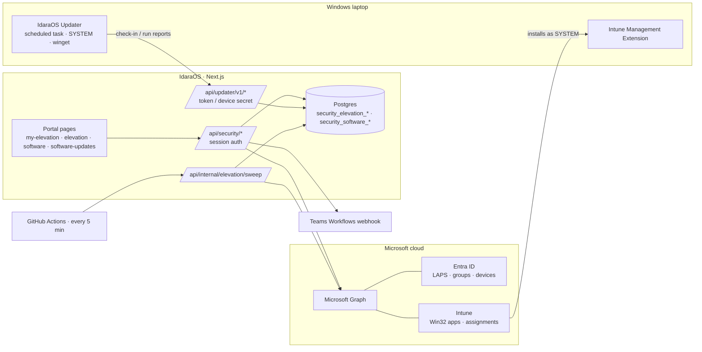
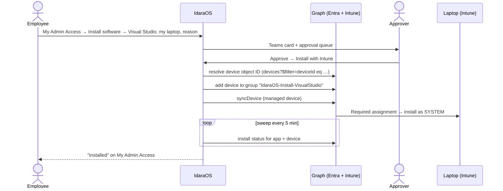

# Security › Endpoint Elevation (Just-in-Time Admin) — Implementation Plan

> Status: **Phase 1 live** (credentials mode) · **Phase 2 built, not deployed** (approved software, Intune installs, IdaraOS Updater) · Owner: Security module · Target: Windows 11, Autopilot Entra-joined, Intune-managed, Windows LAPS backed up to Entra ID · Licensing: Microsoft 365 Business Premium (Intune Plan 1, Entra ID P1) — no add-ons

## 1. Goal

Standard users never hold permanent local admin rights. When they need admin to get something done, they ask in the IdaraOS portal. An approver decides **how** to help, and every step is time-boxed and audited.

| Capability | Who | Summary |
|---|---|---|
| **Approved app install** (Phase 2) | Employee → Approver | Employee picks an app from Approved Software and requests it for their laptop. On approval, IdaraOS adds the device to the app's Intune install group; Intune installs it as SYSTEM. No admin rights and no password reach the user. |
| **Software updates** (Phase 2) | Super admin | The IdaraOS Updater runs `winget upgrade` as SYSTEM on every device, on an org schedule or on demand, and keeps a per-device log of every run, failures included. |
| **Self-service catalog** (Phase 2/3) | Super admin | Apps that never need a request: offered in Company Portal and listed in IdaraOS. |
| **Credentials (Mode A)** (Phase 1, live) | Approver with credential permission | For anything not in the catalog, or apps that need admin on every run. The LAPS password is fetched from Entra via Graph, revealed to the requester for the approved window, and rotated afterwards. |
| Sign-in | Everyone | Microsoft Entra SSO only (existing IdaraOS SSO, `passwordAuthDisabled = true`). |

**Not in scope:** a custom endpoint agent that launches apps elevated, intercepting the native UAC prompt, macOS, on-prem AD LAPS.

### Decision log

**2026-10-29 — Dropped the custom agent / "elevate one app" mode in favour of Intune app deployment.**
- Intune Endpoint Privilege Management needs an add-on licence that Business Premium doesn't include, and we're not buying one.
- A home-built SYSTEM service that receives the LAPS password and launches apps with it would be a high-value target on every laptop, and needs code signing, tamper protection and updates.
- An elevated app is usually a way to get admin on the whole laptop (file dialogs, help links, installer scripts). It also runs in the LAPS account's profile, not the user's. So hiding the password adds little over Mode A.
- Most "I need admin" requests are installs. Intune Win32 apps already install as SYSTEM, are included in Business Premium, and need nothing on the device beyond the Intune Management Extension.
- If "run one app elevated without seeing a password" becomes a hard requirement later, buy a product built for it rather than build it.

**2026-10-29 — Updates run through winget as SYSTEM (the IdaraOS Updater).**
- IT already uses `winget upgrade`. It only prompts for admin because it runs in a user session.
- A scheduled task as SYSTEM runs the same command silently. Intune Remediations would be the built-in option, but they need Windows Enterprise licences.
- The package list comes from Approved Software, so apps added later are updated without redeploying anything.

## 2. Architecture



## 3. Flows

### 3.1 Approved app install



1. The requester picks an Approved Software app whose access is `approval` (and that IT has linked to an install group), one of *their assigned Intune-managed devices*, and a reason. No duration: an install isn't time-boxed.
2. The approver approves with **Install with Intune** (the default for catalog requests) or, if needed, **Credentials**.
3. On approval, IdaraOS:
   - resolves the device's Entra **directory object ID** from its `entraDeviceId` (Graph `GET /v1.0/devices?$filter=deviceId eq '{id}'&$select=id`);
   - adds it to the app's install group (`POST /v1.0/groups/{groupId}/members/$ref`);
   - asks Intune to sync the device (`POST /v1.0/deviceManagement/managedDevices/{intuneId}/syncDevice`) so the install starts in minutes rather than at the next check-in.
   If Graph fails, the install stays `pending` with the error, and the sweep retries up to 5 times. Approvers can also **Retry install**.
4. The grant stays **active** until the app is reported installed. That comes from the Intune install status report, or from the IdaraOS Updater seeing the package. The grant then becomes **completed**. If the install deadline passes first (default 24 h), it ends as **failed** and the device stays in the group, so Intune keeps trying.
5. Optionally (per app) the device is removed from the group once installed. That doesn't uninstall the app.

### 3.2 Self-service and managed apps

- `self_service`: the Intune app is assigned **Available** to a user group. My Admin Access shows **Open in Company Portal** (`companyportal:ApplicationId=<intuneAppId>`). No request.
- `managed`: installed by IT on every device (e.g. Microsoft 365 Apps, Chrome, Git). Listed so users know it's there.

### 3.3 Software updates (IdaraOS Updater)

1. A super admin creates the **enrollment token** (Software Updates → Schedule & enrollment) and deploys the updater as a Win32 app (System) with the token in the install command.
2. On first run the device enrolls:
   - It sends the token, its Entra device ID, Intune device ID, hostname and serial.
   - IdaraOS checks the device is in Assets and the serial matches, then returns a per-device secret.
3. Every few minutes the task checks in. The server returns a **run** when:
   - **Run now** was pressed for that device, or **Run on all devices**; or
   - the org schedule (days, time, time zone) has a time the device hasn't run for yet. A device that was off catches up at its next check-in.
4. A run lists every enabled Approved Software app with `update_method = winget`, a winget ID and **Update automatically** on. For each package, the updater:
   - runs `winget list` to find the installed version;
   - runs `winget upgrade --id <id> --exact --silent`;
   - reports the outcome (`updated` / `up_to_date` / `not_installed` / `failed`), from/to versions, exit code and reboot flag.
5. The report, with the tail of the winget output, is stored as the run's log.
   - Upload failures are queued on the device and sent before the next check-in.
   - A run interrupted by a reboot is marked failed at the next check-in.
   - A run that never reports back is marked failed by the sweep after 4 h.

### 3.4 Credentials (Mode A, live)

1. The approver picks **Credentials**. This needs `security.elevation-credentials:edit` and is allowed only if the org setting enables credential mode.
2. A grant is created with `expiresAt`. The requester sees a **Reveal password** card on `/security/my-elevation` with a countdown.
3. Reveal → `POST /api/security/my-elevation/grants/{id}/reveal`:
   - Requires an SSO sign-in within `recent_auth_minutes` (default 15); otherwise the user re-authenticates with `prompt=login`.
   - Server calls Graph `GET /v1.0/directory/deviceLocalCredentials/{entraDeviceId}?$select=credentials` (headers `ocp-client-name`, `ocp-client-version`), picks the newest `backupDateTime`, base64-decodes `passwordBase64`.
   - Returns `{ accountName, password }` with `Cache-Control: no-store`. Nothing is persisted or logged. `revealCount` and reveal times are recorded.
   - Limited to `max_reveals_per_grant` (default 5).
4. **Rotation once the grant ends:**
   - Only a revealed password is rotated. Revoke rotates immediately; expiry rotates on the next sweep.
   - IdaraOS calls Intune `POST /beta/deviceManagement/managedDevices/{intuneDeviceId}/rotateLocalAdminPassword` and marks `rotationStatus = requested`.
   - The sweep marks it `verified` once Entra holds a LAPS backup newer than the last reveal, and retries failures up to 5 times.
   - **Belt and braces:** the Intune LAPS policy sets post-authentication actions (reset password + log off) with a reset delay no longer than the longest grant.

### 3.5 Ending and revoking

| Grant mode | Ends when | Revoke does |
|---|---|---|
| `credentials` | `expiresAt` passes | Ends the grant now and rotates the password if revealed |
| `app_install` | Installed (**completed**), or the install deadline passes (**expired**, install `failed`) | **Cancel install**: the device leaves the install group if nothing installed yet. **Doesn't uninstall** an installed app; that's done in Intune |

## 4. Intune setup for a catalog app

Each approval-based app needs, in Intune (step by step in `deployment/intune/winget-apps/README.md`):

| Item | Setting |
|---|---|
| App type | Windows app (Win32): the shared `Install-WingetApp.ps1 -Id <WingetId>` package, so every install gets the latest version |
| Install behaviour | **System** |
| Detection rule | Required and specific (file path or `Detect-WingetApp.ps1` copy). Install status in IdaraOS is only as good as this rule |
| Install group | An **assigned** (not dynamic) Entra security group of **devices**, named `IdaraOS-Install-<App>`. Not role-assignable, not used by Conditional Access or any other access policy |
| Assignment | **Required** → the install group |
| Self-service (optional) | **Available** → a user group, for Company Portal |

IdaraOS reads apps and assignments from Intune but **doesn't** create apps, groups or assignments; IT does that in Intune, then links the app in Approved Software. The editor warns when the chosen group isn't a Required assignment target of the chosen app.

## 5. Data model

All tables have `org_id` → `organizations` with cascade delete, matching existing modules.

### Live (migration `0016`)

| Table | Key columns |
|---|---|
| `security_elevation_settings` | `org_id` (unique), `duration_options` jsonb, `max_minutes`, `require_reason`, `credential_mode_enabled`, `require_recent_auth`, `recent_auth_minutes`, `max_reveals_per_grant`, `teams_webhook_url_encrypted` |
| `security_elevation_requests` | `requester_id`, `asset_id`, `device_name`, `entra_device_id`, `intune_device_id`, `app` jsonb, `requested_minutes`, `reason`, `status`, `decided_by_id`, `decided_at`, `decision_note` |
| `security_elevation_grants` | `request_id` (unique), `user_id`, `approved_by_id`, `mode`, `starts_at`, `expires_at`, `status`, `ended_at`, `end_reason`, `revoked_by_id`, reveal tracking, rotation tracking |
| `assets_assets.entra_device_id` | Filled by the Intune asset sync (`azureADDeviceId`) |

### Phase 2 (migration `0017_software_catalog_updates.sql`, built)

| Table / change | Details |
|---|---|
| `security_software_catalog` | Approved Software: `name` (unique per org), `publisher`, `description`, `notes`, `access` (`approval` / `self_service` / `managed`), `enabled`, `winget_id`, `update_method` (`winget` / `self` / `windows_update` / `manual`), `auto_update`, `intune_app_id`, `intune_app_name`, `install_group_id`, `install_group_name`, `remove_from_group_after_install`, `install_deadline_hours` (default 24). The recommended apps (§11) are added once per org |
| `security_software_installs` | One per `app_install` grant: snapshot of app, winget ID, Intune app and group; `entra_device_id`, `intune_device_id`, `device_object_id`; `status` (`pending` / `assigned` / `installed` / `failed` / `cancelled`), `attempts`, `group_added_at`, `sync_requested_at`, `last_checked_at`, `last_intune_state`, `installed_at`, `group_removed_at`, `error` |
| `security_software_update_settings` | Org schedule (`schedule_enabled`, `schedule_days` 0-6, `schedule_time` HH:mm, `schedule_timezone` IANA), `check_in_minutes` (default 15), enrollment token **hash** + hint, `catalog_seeded_at` |
| `security_software_update_devices` | Devices running the IdaraOS Updater: `asset_id`, `entra_device_id` (unique per org), `intune_device_id`, `hostname`, `serial_number`, versions, device secret **hash**, `status` (`active` / `revoked`), `last_seen_at`, `last_run_at`, `last_run_status`, `last_error`, `run_requested_at` / `run_requested_by_id` ("Run now") |
| `security_software_update_runs` | The per-device update log, failures included: `trigger` (`scheduled` / `manual`), `requested_by_id`, `status` (`running` / `succeeded` / `partial` / `failed`), `packages`, per-package `results` (outcome, from/to version, exit code, reboot, message), counts, `error`, `log` (tail, ≤ 64 KB), `started_at`, `finished_at` |
| `security_elevation_requests` | Added `catalog_app_id` → catalog (set null). `requested_minutes` is nullable (installs have no duration). `app` jsonb is `{ name, publisher?, version? }`: the catalog snapshot, or what a credentials request is for |
| `security_elevation_grants` | `mode` is `credentials` / `app_install` (text column, no enum change). New status `completed` = the app was reported installed. For installs, `expires_at` is the install deadline |

**Never stored:** LAPS passwords, the enrollment token or device secrets (hashes only).

## 6. RBAC

| Module slug | Actions | Default roles | Status |
|---|---|---|---|
| `security.my-elevation` | `view`, `create` | Everyone | Live |
| `security.elevation` | `view` (queue/history), `edit` (approve/deny/revoke, includes **Install with Intune** and **Retry install**) | IT Admin, Security Admin | Live |
| `security.elevation-credentials` | `edit` (may choose Mode A) | Security Admin only | Live |
| `security.elevation-settings` | `view`, `edit` | Admin | Live |
| `security.software` | `view`, `create`, `edit`, `delete` - Approved Software | Super Admin | Phase 2 |
| `security.software-updates` | `view` (devices, update log), `edit` (schedule, Run now, Run on all devices, revoke device, enrollment token) | Super Admin | Phase 2 |

`sync-rbac` grants new slugs to Owner only; assign them to other roles in Settings › Roles.

Server-enforced business rules (on top of RBAC):
- The requester can't decide their own request.
- Install requests need an enabled `approval` catalog app with an install group, and an Intune-managed device assigned to the requester.
- **Install with Intune** is only possible for those requests. An approver can still choose **Credentials** for them.
- Credentials: approved minutes ≤ requested minutes (or `max_minutes` when none was requested) ≤ `max_minutes`; refused if `credential_mode_enabled = false`.
- One open request or active grant per device for credentials, and per (device, app) for installs.
- Winget IDs must match `^[A-Za-z0-9][A-Za-z0-9.+_-]{0,127}$` (no `..`), checked on save, in run reports, and again on the device.

## 7. API surface

Session auth with `requirePermission(...P.security.…)` + `handleApiError`, like existing routes.

| Method & path | Purpose |
|---|---|
| `GET, POST /api/security/my-elevation` | My devices, requests, grants, install status and the catalog (with `requestable` / Company Portal link); create a request: `{ assetId, catalogAppId?, minutes?, appName?, reason }` |
| `POST /api/security/my-elevation/requests/[id]/cancel` | |
| `POST /api/security/my-elevation/grants/[id]/reveal` | Mode A password (no-store, recent-auth, rate-limited) |
| `GET /api/security/elevation/requests` | Approver queue / history, with install status and `installReady` |
| `POST /api/security/elevation/requests/[id]/approve` | `{ mode: "app_install" \| "credentials", minutes?, note }`. Installs: grant + install row in one transaction, then group add + `syncDevice` |
| `POST /api/security/elevation/requests/[id]/deny` | `{ note }` |
| `POST /api/security/elevation/grants/[id]/revoke` | Credentials: end + rotate. Installs: cancel, device leaves the group |
| `POST /api/security/elevation/grants/[id]/rotate` | Rotate LAPS password now |
| `POST /api/security/elevation/grants/[id]/retry-install` | Re-add to group + sync with a new deadline |
| `GET, POST /api/security/software` · `PATCH, DELETE /api/security/software/[id]` | Approved Software CRUD (warns when the install group isn't a Required target of the Intune app) |
| `GET /api/security/software/intune-apps?search=` | Intune Win32 + Store (new) apps with their assignment groups |
| `GET /api/security/software-updates` | Updater devices, schedule (+ next run), update package list, stats |
| `PATCH /api/security/software-updates/settings` | Schedule + check-in interval |
| `POST /api/security/software-updates/enrollment-token` | Create / replace the token (returned once, no-store) |
| `POST /api/security/software-updates/devices/[id]/run` · `POST …/run-all` | Run now on one device / every active device (picked up at next check-in) |
| `POST /api/security/software-updates/devices/[id]/revoke` | Stop accepting a device (logs kept) |
| `GET /api/security/software-updates/runs?deviceId=&status=` · `GET …/runs/[id]` | Update log; one run with results and device log |
| `GET, PATCH /api/security/elevation/settings` | |

**Device (IdaraOS Updater, `/api/updater/v1/*`, excluded from session auth in `middleware.ts`):**

| Method & path | Auth | Purpose |
|---|---|---|
| `POST /enroll` | Enrollment token | Device must be in Assets with the same Entra device ID (and serial, when Assets has one). Revoked devices are refused. Returns a per-device secret once |
| `POST /check-in` | `Bearer <deviceId>.<secret>` | Heartbeat + versions + `lastError`. Marks any `running` run interrupted, then returns a run when Run now was requested or the schedule is due |
| `POST /runs/[id]` | `Bearer <deviceId>.<secret>` | Per-package results, error, log tail. A late report replaces a run the sweep marked failed |

**Internal:** `POST /api/internal/elevation/sweep` (header `x-internal-secret: $INTERNAL_CRON_SECRET`), every 5 min from `.github/workflows/elevation-sweep.yml`. It:
- expires credential grants and rotates revealed passwords;
- assigns pending installs (retries up to 5 times);
- checks Intune install status, with the updater's last run as a second signal, and completes installed grants;
- fails installs past their deadline;
- marks update runs failed when the device hasn't reported in 4 h.

## 8. Server code layout

```
apps/web/
  lib/db/schema/security-elevation.ts          requests, grants, settings
  lib/db/schema/security-software.ts           catalog, installs, updater settings / devices / runs
  lib/security/
    elevation.ts                               pure rules (approval incl. app_install, reveal, rotation)
    elevation-laps.ts                          LAPS read, last backup, rotate
    elevation-server.ts                        settings, expiry, rotation, full sweep
    elevation-notify.ts                        Teams card (request summary)
    software.ts                                pure: labels, winget ID rule, recommended apps, schedule maths, run summary
    software-intune.ts                         Graph: Intune apps + assignments, device object ID, group add/remove, syncDevice, install status report
    software-server.ts                         catalog seed, update package list, install start/check/cancel/retry, stale runs
    software-updates-server.ts                 device auth, run dispatch (schedule / Run now), run reports
    software-validation.ts                     catalog zod schema + cross-field rules
  lib/api/security-elevation.ts · security-software.ts   React Query hooks
  app/api/security/elevation/** · my-elevation/** · software/** · software-updates/**
  app/api/updater/v1/{enroll,check-in,runs/[id]}
  app/(dashboard)/security/{my-elevation,elevation,software,software-updates}/
  components/security/{elevation,software}/
deployment/intune/
  idaraos-updater/                             Install / Uninstall / Detect scripts + IdaraOS-Updater.ps1 (README)
  winget-apps/                                 Install-WingetApp.ps1, Install-WSL.ps1, detection template, .vsconfig (README)
```

Portal actions go through the existing audit logger under `security.elevation`, `security.software` and `security.software-updates`. System actions (install assigned / completed / failed, enrollment) are logged with a system actor.

## 9. Graph permissions

Application permissions on the IdaraOS app registration, with admin consent. Kept in `deployment/azure/scripts/register-entra-app.ps1` and listed on Settings › Integrations › Device Management.

| Permission | Used for | Status |
|---|---|---|
| `DeviceManagementManagedDevices.Read.All` | Asset sync | Live |
| `DeviceManagementServiceConfig.Read.All` | Asset sync | Live |
| `DeviceLocalCredential.Read.All` | LAPS read | Live |
| `DeviceManagementManagedDevices.PrivilegedOperations.All` | LAPS rotate, `syncDevice` | Live |
| `DeviceManagementApps.Read.All` | List Intune apps, assignments, install status | Phase 2 (needs consent) |
| `Device.Read.All` | Resolve the device's directory object ID | Phase 2 (needs consent) |
| `GroupMember.ReadWrite.All` | Add/remove the device in install groups | Phase 2 (needs consent) |

`GroupMember.ReadWrite.All` lets the app change the members of **any** group that isn't role-assignable. Mitigations:
- The server only ever touches groups stored on an enabled catalog app, and only adds/removes **devices** resolved from the requester's own assigned asset.
- Catalog edits need `security.software` and are audited.
- Groups that grant access elsewhere (Conditional Access exclusions, admin groups, licensing) should be role-assignable or in a restricted management administrative unit, so this app can't change them.
- Phase 4: move to a certificate credential, or a separate app registration used only for LAPS and group writes.

## 10. Threat model highlights

| Threat | Mitigation |
|---|---|
| Requesting an app for someone else's laptop | Device picker only shows the requester's assigned assets; server re-checks the assignment |
| Self-approval / collusion | Server rule: approver ≠ requester; full audit; monthly report as ISMS evidence |
| Catalog misuse (pointing an app at a sensitive group) | Super-admin-only catalog, audited edits, assignment check against Intune, group hygiene (§9) |
| Malicious or tampered installer | Apps are packaged by IT in Intune; winget verifies installer hashes from its manifests; the requester never supplies a binary |
| Updater used to run code as SYSTEM | The server only sends winget package IDs from Approved Software; IDs are validated on the server and the device; the updater only runs `winget list` / `winget upgrade` |
| Stolen enrollment token | Only enrolls devices already in Assets with a matching serial; replace it any time; revoked devices can't re-enroll |
| Stolen device secret | Hashed on the server; DPAPI (machine) in a SYSTEM/Administrators-only folder on the device; revoke the device in IdaraOS |
| Mode A abuse (admin password = full control) | Separate permission, org toggle, short durations, recent-auth reveal, reveal limit, rotation after use, LAPS post-auth reset; **Install with Intune** is the default for catalog apps |
| Password leakage | Never persisted or logged; `no-store`; shown only to the grantee |
| Over-privileged Graph app | Least permissions per phase; certificate credential in Phase 4 |

**Compliance tie-in:** ISO 27001:2022 Annex A **8.2** (privileged access rights), **8.8** (technical vulnerabilities: patching evidence from the update log), **8.19** (installation of software on operational systems), **8.15** (logging), **5.18** (access rights). Phase 4 publishes a monthly report into the Security › Evidence store.

## 11. Phased delivery

### Phase 0 — Prerequisites & checks
- [x] Add Graph permissions and consent. Prove `deviceLocalCredentials` read and `rotateLocalAdminPassword` against a test device.
- [ ] Confirm the Intune LAPS policy manages an **enabled** account. Set post-authentication actions (reset + log off) and a reset delay ≤ the longest grant.
- [ ] Package one test app (e.g. 7-Zip) with `Install-WingetApp.ps1` and a detection rule. Assign it **Required** to an assigned device group `IdaraOS-Install-7Zip`.
- [ ] Add a test device to that group via IdaraOS and measure time to install, with and without `syncDevice`.
- [ ] Confirm the Intune install status report (`deviceManagement/reports/getDeviceInstallStatusReport`, beta) returns the device with its state, and how long it lags.
- [ ] Confirm the Company Portal deep link (`companyportal:ApplicationId=<intuneAppId>`) opens the app page for a standard user.
- [ ] Confirm winget runs as SYSTEM on a pilot device (App Installer provisioned) and the updater enrolls and reports a run.
- [x] Add `DeviceManagementApps.Read.All`, `Device.Read.All` and `GroupMember.ReadWrite.All` to `register-entra-app.ps1`. *Consent still needed.*

**Exit:** results of each check appended to this doc.

### Phase 1 — Server foundation + Mode A (live)
- [x] Schema + migration `0016`, RBAC slugs + seed, settings page.
- [x] Asset sync stores `entra_device_id`.
- [x] LAPS lib, rules, sweep endpoint, `elevation-sweep.yml` cron. *The sweep stays off (503) until `internal-cron-secret` is in each Key Vault.*
- [x] Portal request flow at **device level** (pick one of *my assigned assets*), approval queue, approve dialog, reveal card with countdown, Intune-only rotation, Teams card.
- [x] Verified against a real tenant on 2026-10-29: Graph consent, request → approve → LAPS reveal, revoke → rotation. *Rotation on natural expiry still needs the sweep secret.*

**Exit:** an employee can request admin on their laptop, an approver grants credentials, the password is revealed, and Graph shows it rotated after the grant ends. All steps appear in the audit log.

#### Phase 1 — as built

- **Code location:** `lib/security/elevation.ts` (pure rules), `elevation-laps.ts` (Graph), `elevation-server.ts` (settings, expiry, rotation), `elevation-notify.ts` (Teams).
- **Tables:** `security_elevation_settings`, `security_elevation_requests`, `security_elevation_grants`, plus `assets_assets.entra_device_id`. Requests point at the **asset** and snapshot `entra_device_id` / `intune_device_id`.
- **RBAC:** `security.my-elevation`, `security.elevation`, `security.elevation-credentials`, `security.elevation-settings`. `sync-rbac` grants new slugs only to Owner on existing orgs; assign them to other roles in Settings › Roles.
- **Recent sign-in:** `/api/auth/login/azure-ad?reauth=1` adds `prompt=login`. Reveal checks the session JWT `iat` against `recent_auth_minutes`.
- **Rotation:** never-revealed grants end with `not_required`. Revoke requests rotation immediately; the sweep retries failures up to 5 times; approvers can "Rotate password now" from History.
- **Sweep:** returns 503 until `INTERNAL_CRON_SECRET` is set. List endpoints also expire due grants on read, so statuses are never stale.

### Phase 2 — Approved software, Intune installs and software updates (built, not deployed)
- [x] Migration `0017_software_catalog_updates`: catalog, installs, updater settings / devices / runs; `requests.catalog_app_id`, nullable `requested_minutes`; mode `elevate_app` → `app_install`, grant status `completed`.
- [x] RBAC slugs `security.software` and `security.software-updates` + seed/sync; sidebar entries **Approved Software** and **Software Updates**.
- [x] `lib/security/software-intune.ts` (GUID validation, `IntuneError` codes) with mocked-fetch unit tests.
- [x] Approved Software page: add / edit / delete apps, search Intune apps, pick the install group from the app's assignments, warning when it isn't a Required target. Recommended apps added once per org.
- [x] My Admin Access: **Install software** cards (request / Company Portal / installed by IT); credentials requests can say what they're for.
- [x] Approve dialog: **Install with Intune** (default for catalog requests) vs **Credentials**. Queue and history show install status, errors, **Retry install** and **Cancel install**.
- [x] Sweep: assign pending installs, read install status (Intune report, then the updater's last run), complete / fail at deadline, optional group removal.
- [x] **IdaraOS Updater** (`deployment/intune/idaraos-updater`): SYSTEM scheduled task; enrolls with the org token, checks in, runs `winget upgrade` for every enabled catalog app with a winget ID and automatic updates on. Apps added later are picked up on the next run.
- [x] Per-device update log: every run with per-package outcome, versions, exit code, reboot flag and log tail, including failures, interrupted runs and runs that never reported back.
- [x] Super admin: org-wide schedule (days, time, time zone), **Run now** per device, **Run on all devices**, revoke device, enrollment token.
- [x] Win32 install wrappers (`deployment/intune/winget-apps`): `Install-WingetApp.ps1`, `Install-WSL.ps1`, detection template, `.vsconfig`.
- [x] Unit tests: approval rules for both modes, winget ID rule, schedule maths (time zones, daylight saving, catch-up), run summary, Graph helpers, device auth.
- [ ] Deploy: `internal-cron-secret` in Key Vault (the sweep drives install tracking), consent for the three new Graph permissions, run migration `0017`.
- [ ] Phase 0 checks on a pilot device.
- [ ] Package the updater and the approved apps in Intune; link each app to its install group in Approved Software.

**Exit:** a pilot group of 5–10 users installs catalog apps through approval without admin rights or a password, and every pilot device shows a scheduled update run in its log.

#### Phase 2 — as built

- **Recommended apps** (editable, added once per org):

  | App | Access | Updates |
  |---|---|---|
  | Microsoft 365 Apps | Every device | Own updater |
  | Google Chrome | Every device | Own updater |
  | Git | Every device | Updater (`Git.Git`) |
  | Visual Studio 2022 Professional | Approval | Updater |
  | SQL Server Management Studio | Approval | Updater |
  | SQL Server 2022 Developer | Approval | Windows Update |
  | NVM for Windows | Approval | Updater |
  | WSL | Approval | Updater |

- **The updater never installs apps.** Installs are Intune's job (approval → install group). The updater only upgrades packages that are already installed, so a package that isn't on the device is reported as `not_installed`.
- **Run dispatch is server-side.** The device checks in every `check_in_minutes` (the task itself wakes every 5 min). The server decides if a run is due:
  - once per scheduled time;
  - a device that was off catches up at its next check-in;
  - times before enrollment are skipped.
- **Interrupted runs.** The device never checks in mid-run, so a `running` run at check-in means the run was interrupted, and it's marked failed. Reports that fail to upload are queued on the device and sent before the next check-in.
- **Enrollment** requires the device to be in Assets (from the Intune sync) with a matching serial. Tokens and secrets are stored as SHA-256 hashes. On the device they're DPAPI (machine) in a SYSTEM/Administrators-only folder.
- **Install status:**
  - The Intune device install status report (beta) is read defensively by column name.
  - A successful updater run that sees the package counts as installed too.
  - Phase 0 still has to confirm the report's columns and lag.
- **Tested locally** against the dev database and API:
  - enrollment: bad token, serial mismatch, success;
  - device auth;
  - Run now dispatch, with a newly added app included;
  - interrupted run, late report, failed run with error;
  - install request rules: app not set up, duplicate, self-approval;
  - approval with Graph unavailable (`pending` + error), retry, cancel;
  - credentials approval and revoke.
- **Not tested yet:** a real device, real Intune and real Graph.

### Phase 3 — Self-service catalog & insights (≈1 week)
- [x] `self_service` apps with an **Open in Company Portal** link (built in Phase 2).
- [ ] "Always allow this app" from an approved install.
- [ ] Report: most-requested "other" apps (packaging backlog), credentials grants per app, and devices behind on updates.

**Exit:** a super admin marks an app self-service; scoped users install it from Company Portal with no request.

### Phase 4 — Hardening & reporting (≈1–2 weeks)
- [ ] Certificate credential for the Graph app, or a separate app registration for LAPS + group writes.
- [ ] Reports (requests per app/user, median approval time, install success rate, update success rate) + monthly ISMS evidence export.
- [ ] Retention for requests/grants/installs/update runs (suggest 13 months).
- [ ] Rate limiting on `/api/updater/v1/enroll`.
- [ ] Optional: refuse Mode A when an `approval` catalog app exists for the requested app.

## 12. Testing

- **Unit (Vitest):**
  - `tests/unit/security-elevation.test.ts`: approval rules for both modes, reveal, rotation, LAPS parsing.
  - `tests/unit/security-software.test.ts`: winget ID rule, schedule maths, run summary, catalog rules, device auth parsing, Graph helpers (object ID, group add/remove, install status report).
- **E2E (Playwright):** request → approve (install and credentials) → reveal → revoke; RBAC denial paths; catalog CRUD; Run now → run appears in the log.
- **Manual matrix on a pilot laptop:**
  - Install via approval: online device, device asleep/offline at approval (installs on next check-in), install failure (bad detection rule → `failed` at deadline), retry.
  - Cancel before install (device leaves the group, nothing installs).
  - Optional group removal after install (app stays installed).
  - Self-service install from Company Portal.
  - Updater: enroll, scheduled run, Run now, app open during upgrade (failed with "app is open", updated next run), reboot mid-run (interrupted), offline upload (sent next check-in), newly added catalog app picked up.
  - Credentials grant: reveal, expiry via sweep, revoke, rotation verified.

## 13. Open items

- Approver routing: any `security.elevation:edit` holder (v1), or the requester's manager first (later, via People org chart)?
- "Other app" requests: allow credentials as today, or require IT to package the app first?
- Should cancelling an installed app trigger an uninstall (a second, Uninstall-assigned group), or stay manual in Intune?
- Per-device or per-group update schedules (today one schedule for the whole org)?
- Data retention for requests, grants, installs and update runs (suggest 13 months, matching audit evidence needs).
